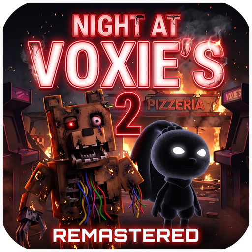
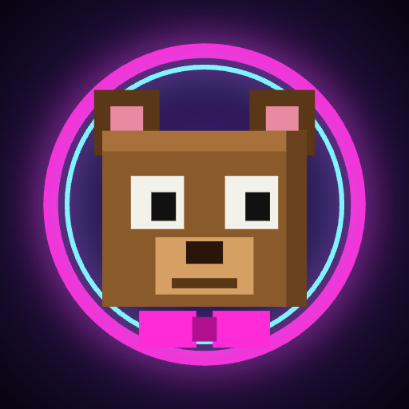

# Night at Voxie's

Hororová série z kostičkového světa herny **Voxie's Fun Factory**: noční hlídání, animatronici se springlocky, duše, které zůstaly v oblecích, a požáry, které nic neukončí.

| | | |
|:-:|:-:|:-:|
|  |  |  |
| **Night at Voxie's 1 Remastered** | **Night at Voxie's 2 Remastered** | **Night at Voxie's 3 – Frights & Hides** |
| `voxies_godot/` · Godot 3.0.0 | `voxies2_godot/` · Godot 2.7.0 | `voxies3_godot/` · Godot 1.0.1 |

## Hry

### Night at Voxie's 1 Remastered (`voxies_godot/`)
Herna Voxie's, rok 2023. Hlídáš sedm nocí v kanceláři pana Vojtěcha, kamery, Voxie Bear a Cocoa. Denní směny, D. a děti, easter egg „Po zavíračce“.

### Night at Voxie's 2 Remastered (`voxies2_godot/`)
Týden po požáru. Vyhořelá budova, počítač s Windows 98 na baterii, VOXIE-CAM, Hollow Bunny ve skladu, díra přes toalety, inventář a fotky pro Voxieho. Konce se zatčením náčelníkem Králem, vězením a selháním springlocků D.

### Night at Voxie's 3 – Frights & Hides (`voxies3_godot/`)
Strašidelná atrakce pana Kroupy z relikvií herny. Windows XP, hlášení, kamery a Hollow Hare – Hollow Bunny s D. uvnitř, který se vždycky dívá do kamery. Sanity, energie, Shadow Voxie a Shadow D., úkoly v budově a sedmá noc, kdy Frights & Hides lehne popelem. Custom Night, Extras a lore.

### Night at Voxie's 4 – Nightmare (připravuje se)
Malá Ema a její noční můry. Dům s pokojíčkem, baterka, bouřka za oknem; Nightmare Voxie a Nightmare Hollow Bunny se bojí světla a jako jediní umí otevírat dveře. Zatím modely a mapa (`voxies3_godot/tools/nightmares.gd`, `voxies3_godot/tools/ema_house.gd`).

## Starší webové verze
Původní verze her (HTML/three.js zabalené přes Capacitor): `voxies/`, `voxies2/`, `voxies2r/`, `voxies3/`, `voxies4/`, `voxies5/`, `voxiescn/` (Custom Night).

## Sestavení (Godot)
Projekty jsou pro **Godot 4.3** (renderer *Compatibility*). APK se exportuje presetem `Android`:

```
godot --headless --path voxies3_godot --export-debug "Android" export/NightAtVoxies3-Godot.apk
```

3D modely (`models/*.glb`) a hotové APK nejsou v gitu – modely se generují nástroji ve složkách `tools/`.

---
Původní projekt VoxelCraft (`Voxel.html`, `Voxel Craft alpha.html`) zůstává v kořeni repozitáře.
